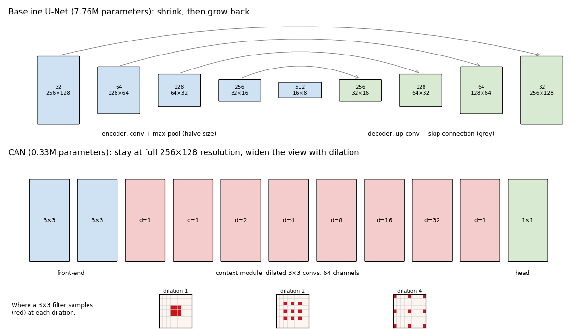
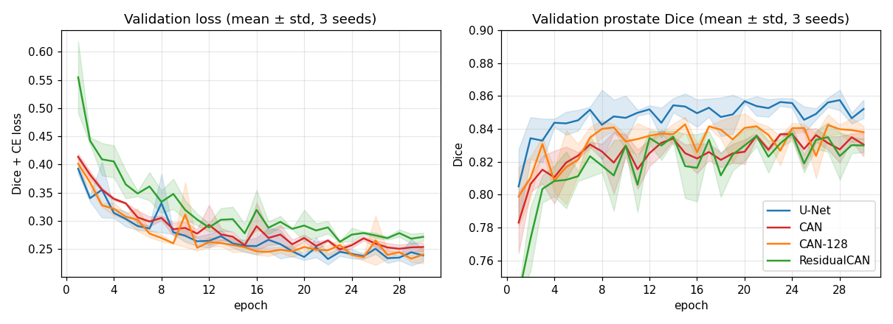
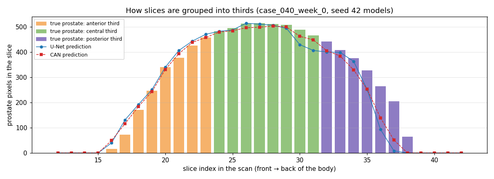
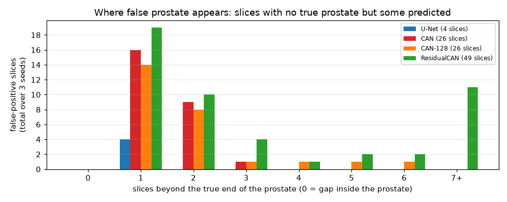
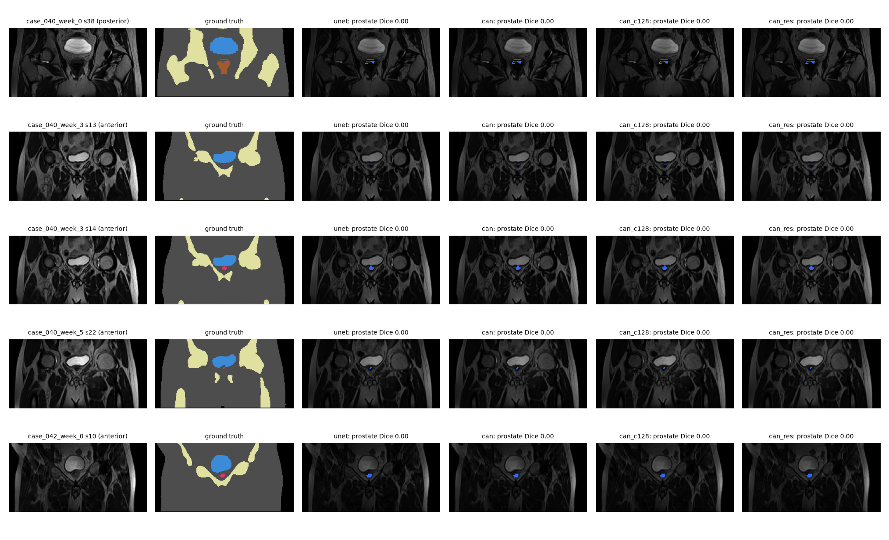
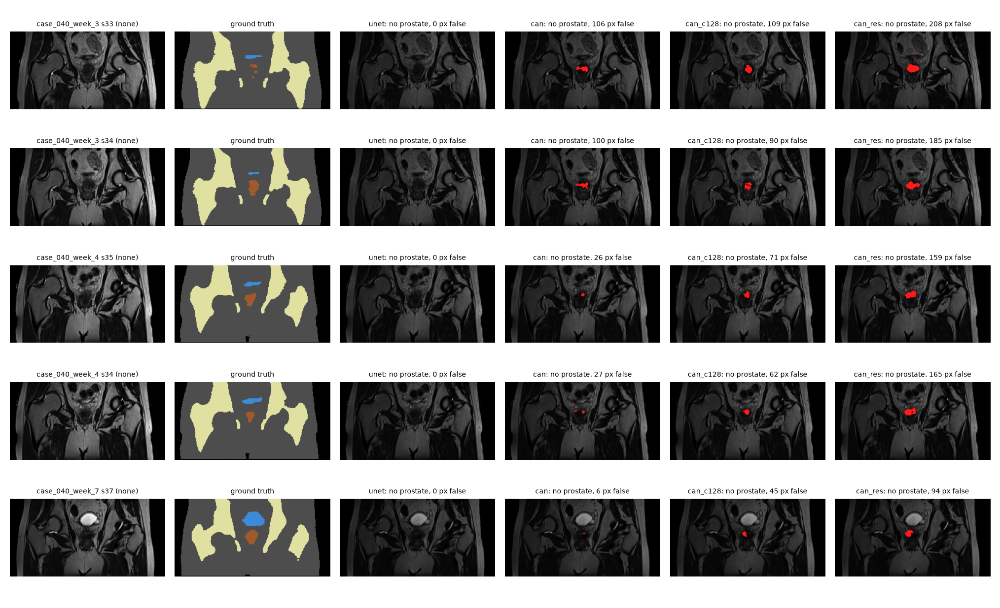
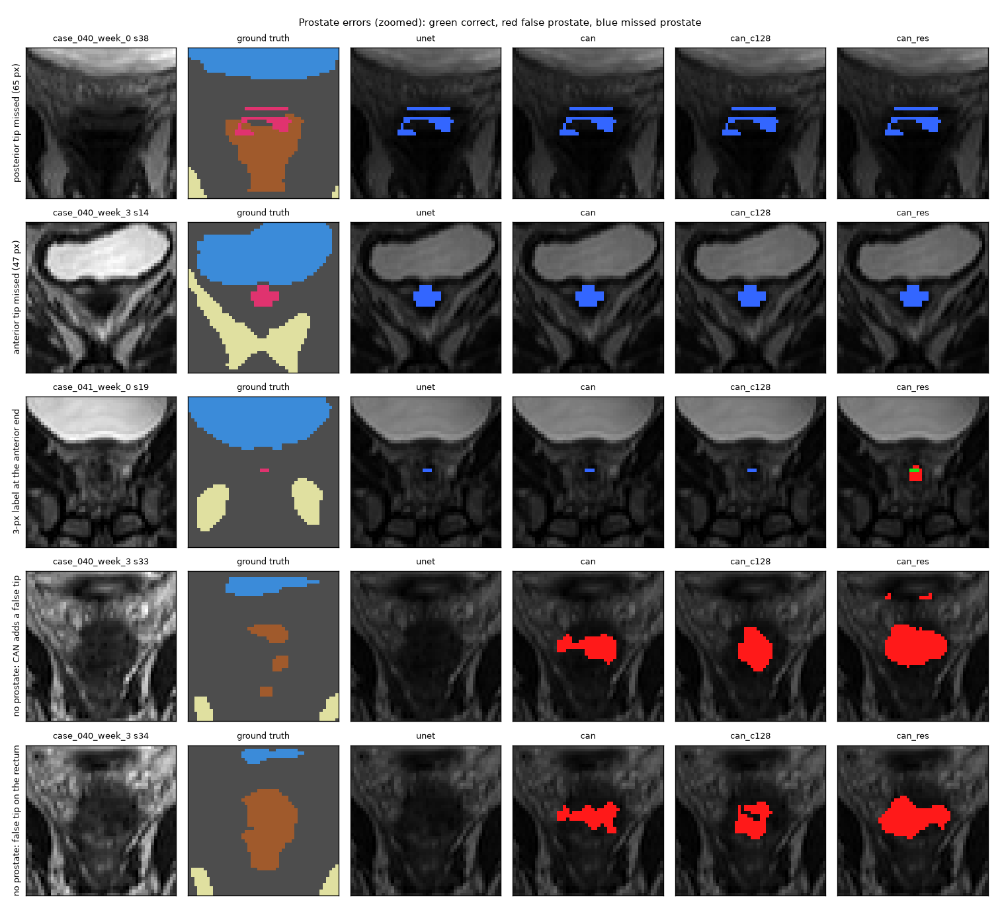
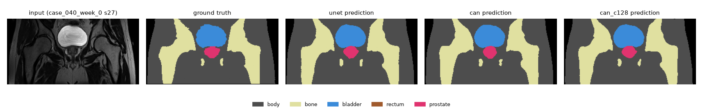

# 2D Context Aggregation Network for Prostate MRI Segmentation (HipMRI)

**Student:** s5042697 · **Project:** 2.2 Segmentation · **Model:** 2D CAN [Normal difficulty] · **Baseline:** 2D U-Net

## Contents

1. [Problem](#1-problem)
2. [How the CAN works](#2-how-the-can-works)
3. [Feasibility review](#3-feasibility-review)
4. [Data and preprocessing](#4-data-and-preprocessing)
5. [Training set-up](#5-training-set-up)
6. [Results: CAN vs U-Net](#6-results-can-vs-u-net)
7. [Failure case analysis](#7-failure-case-analysis)
8. [Recommendation](#8-recommendation)
9. [Usage](#9-usage)
10. [Dependencies and reproducibility](#10-dependencies-and-reproducibility)
11. [Artificial Intelligence Usage Disclosure](#11-artificial-intelligence-usage-disclosure)
12. [References](#12-references)

## 1. Problem

External-beam radiotherapy for prostate cancer needs the prostate and nearby organs at risk (bladder, rectum, bones) contoured on every MRI slice. Doing this by hand is slow. This project builds a prototype that proposes a draft contour for a specialist to review and correct.

The model segments each 2D pelvic MRI slice from the HipMRI study into six labels: background, body, bone, bladder, rectum and prostate. The prostate covers under 0.5% of the pixels.

**The engineering dilemma.** A high overall Dice score can hide the failures that matter clinically such as a missed prostate label at the base and apex, or contours that leak into the rectum or bladder. This project asks whether the multi-scale context of a Context Aggregation Network (CAN) fixes these boundary failures compared with a plain 2D U-Net, or whether it only does as well on the easy central slices while costing more compute.

## 2. How the CAN works



*Top: the U-Net halves the image size four times (box height shows resolution, labels show channels and size), then grows it back, with skip connections (grey) carrying detail across. Bottom: every CAN layer stays at 256×128. The red dilated layers widen the view instead. The small grids show which pixels a 3×3 filter samples at dilations 1, 2 and 4.*

A U-Net shrinks the image to see a wide area, then grows it back, using skip connections to recover detail. The CAN (Yu and Koltun, 2016) never shrinks the image. It widens its view with **dilated convolutions**: 3×3 filters that sample pixels with gaps between them. A filter with dilation *d* still has 9 weights but covers a (2*d*+1)×(2*d*+1) area.

The network in [`modules.py`](modules.py) has three parts:

1. **Front-end:** two ordinary 3×3 convolutions that pick up local features such as edges.
2. **Context module:** eight 3×3 convolutions with dilations 1, 1, 2, 4, 8, 16, 32, 1. Doubling the dilation grows the receptive field exponentially, so each output pixel draws on about 135 px of surroundings: the prostate plus the bladder, rectum and pelvic bones around it.
3. **Head:** a 1×1 convolution that turns each pixel's 64 features into scores for the six labels.

Every layer runs at the full 256×128 resolution, so small structures are never shrunk away. Both models use batch norm and ReLU, so the comparison isolates "dilated full-resolution context" against "encoder-decoder downsampling".

| Model | Parameters | Receptive field | Resolution inside the network |
|---|---|---|---|
| U-Net (baseline) | 7.76M | ~188 px | 256×128 down to 16×8 |
| CAN | 0.33M | ~135 px | 256×128 throughout |
| CAN-128 (wider) | 1.33M | ~135 px | 256×128 throughout |
| ResidualCAN | 0.33M | ~145 px | 256×128 throughout |

**ResidualCAN** is a variant tried after the first results ([Section 6.3](#63-can-variants)). It has the same size as the CAN but changes the context module in two ways:

1. **More even dilations** (1, 2, 5, 9, 17, 33, 2, 1 instead of doubling), so all nearby pixels are weighted more evenly. This reduces "gridding" (Wang et al., 2018).
2. **Each layer starts by passing its input through unchanged** and learns a correction on top. This follows the identity initialisation Yu and Koltun recommend for the context module.

## 3. Feasibility review


### 3.1 User Need, Scope and Acceptance Criteria

**User:** a radiation oncology team contouring the prostate on pelvic MRI before external-beam radiotherapy. **Prototype purpose:** propose a draft multi-structure contour (prostate, bladder, rectum, bone, body) on each 2D slice that a specialist reviews and corrects, reducing manual contouring time.

**Open dilemma:** a good global Dice can hide dangerous failures at the prostate base and apex, or boundary leakage into the rectum and bladder. The question is whether the multi-scale context of a Context Aggregation Network (CAN) fixes these boundary failures compared with a plain 2D U-Net, or only improves easy central slices while costing more compute.

**Acceptance criteria (all on the held-out test patients):**

1. **Accuracy:** prostate Dice ≥ 0.75 for the CAN.
2. **Baseline comparison:** per-class Dice and IoU reported for both models on identical patient-level splits; no patient appears in more than one split.
3. **Boundary failure analysis:** prostate Dice reported separately for the base, apex and edge slices versus central slices, with 3–5 failure cases visualised (input, ground truth, prediction, error overlay).
4. **Resources:** training completes within one 8-hour Rangpur GPU job per model; peak GPU memory and per-case inference time reported.

### 3.2 Model Choice and Course Concepts

- **Data:** HipMRI 2D slices (`keras_slices_data`), 256×128, six labels (background, body, bone, bladder, rectum, prostate). The provided train/validate/test folders are already split by patient (31 / 4 / 3) and are used unchanged.
- **Baseline:** 2D U-Net: encoder-decoder with skip connections, max-pool downsampling, batch norm.
- **Chosen model:** 2D Context Aggregation Network (CAN) (Normal difficulty). Instead of shrinking and re-growing the image like a U-Net, it widens its view while staying at full size:
  1. **Front-end:** two ordinary 3×3 convolutions pick up local features such as edges.
  2. **Dilated convolutions:** 3×3 filters with gaps between the pixels they look at. They still use 9 weights, but cover a much wider area.
  3. **Doubling dilation:** the gaps grow 1, 1, 2, 4, 8, 16, 32, 1 across the context module, so each pixel's prediction draws on about 135 pixels of surroundings (prostate plus bladder, rectum and bones).
  4. **Full resolution throughout:** no pooling or upsampling, so small structures are never shrunk away.
  5. **1×1 classifier:** turns each pixel's features into scores for the six labels.
- **Comparison set-up:** both models use batch norm with ReLU and identical training settings. The CAN uses 64 channels, as in a standard context module, giving 0.33M parameters against 7.76M for the baseline.
- **Course concepts:** convolutional encoder-decoders, dilated convolutions and receptive fields, skip connections, normalisation layers, augmentation, and Dice + cross-entropy loss to handle class imbalance.

### 3.3 Preliminary Feasibility Evidence

**Data audit:** 11,460 / 660 / 540 slices across train / validate / test with no patient overlap. Severe class imbalance: prostate 0.43% and rectum 0.36% of training pixels. One case (`case_019_week_1`, 60 slices) is 256×144 and is centre-cropped to 256×128.

**Pilot runs** (5 epochs, first 1,500 training slices ≈ 4 patients, full validation and test splits, Apple M2):

| Model | Params | Test prostate Dice | Test bladder Dice | Test rectum Dice | Time / 1,500-slice epoch |
|---|---|---|---|---|---|
| Baseline U-Net | 7.76M | 0.81 | 0.95 | 0.80 | ~90 s |
| CAN | 0.33M | 0.79 | 0.95 | 0.78 | ~170 s |

Both models pass the 0.75 prostate target after a short run, so the target seems achievable. The CAN reaches similar accuracy with 23× fewer parameters, but is about 2× slower per epoch because every layer works on the full-size image. A short single run on about 4 patients cannot separate the two models; full runs are needed.

### 3.4 Risks, Budget and Fallback

| Risk | Mitigation |
|---|---|
| Only 3 test patients and 4 validation patients make scores noisy | Report per-patient results and avoid over-claiming; select checkpoints on validation prostate Dice only |
| Global Dice hides base/apex failures | Analyse prostate Dice by position (base, apex, edge slices), as in criterion 3 |
| Full-resolution layers make the CAN slow and memory-hungry | Measure peak GPU memory and per-case inference time; reduce batch size if needed |
| CAN does not beat the baseline | A valid finding for the dilemma, report it with evidence |

**Compute budget:** about 30 epochs per model, at most one 8-hour Rangpur GPU job each, plus short test jobs.

**Next experiment:** full 30-epoch training of both models on Rangpur (3 seeds each), then per-slice failure analysis in `predict.py`.

**Fallback:** if the full runs show no clear accuracy gain from the CAN, use the repeat seeds and a wider CAN (128 channels) to confirm the result is real and not caused by its small size, then recommend the cheaper model with the evidence. If prostate Dice falls below 0.75 on the stricter per-slice average, tune the loss weighting and augmentation and extend training. Edge-slice failures are reported as a limitation, with a recommendation for mandatory human review of those slices.

## 4. Data and preprocessing

**Dataset:** HipMRI 2D slices (`keras_slices_data`, Rangpur `/home/groups/comp3710/HipMRI_Study_open`), stored as Nifti files and loaded with `nibabel`.

| Split | Patients | Slices |
|---|---|---|
| Train | 31 | 11,460 |
| Validate | 4 | 660 |
| Test | 3 | 540 |

**Why these splits.** The provided folders are already split by patient, and they are used unchanged. [`dataset.py`](dataset.py) asserts that no patient ID appears in more than one split, because slices from the same patient are highly correlated, so a patient-level leak would inflate test scores. The weakness of this dataset is size as 3 test patients and 4 validation patients make the scores noisy. To partially mitigate this, every model is trained with 3 seeds and results are reported as mean ± standard deviation.

**Preprocessing:**

- **Shape:** slices are 256×128, except `case_019_week_1` (256×144), which is centre-cropped to 256×128. Cropping keeps the pixel spacing, unlike resizing.
- **Labels:** integer masks, converted to one-hot channels inside the loss.

**Intensity normalisation.** MRI brightness has no fixed scale: the same tissue can be much brighter in one scan than another. So each slice is rescaled to have an average brightness of 0 and a spread of 1 (a z-score). The model then sees every slice on the same scale, whichever scan it came from.

**Augmentation (training only).** Each time a training slice is loaded, it is changed slightly at random, so the model learns the anatomy instead of memorising the 31 training patients:

| Change | Why it is realistic |
|---|---|
| Mirror left-right (50% of the time) | the pelvis is roughly symmetric |
| Rotate up to ±10° | patients do not lie perfectly straight |
| Shift up to ±5% | the body is not always centred |
| Zoom 0.9–1.1× | body sizes differ |

Three details:

- **The mask gets the same change as the image**, so the labels stay lined up with the anatomy. When the mask is rotated, each pixel copies its nearest label rather than averaging two labels, which could create a label that was never there.
- **No upside-down flip**, because a pelvis with the bladder below the prostate never occurs in a real scan.
- **Augmentation happens before normalisation.** Rotating and shifting leave empty corners that are filled with 0. Before normalisation 0 is black, matching the background around the body. After normalisation 0 would be average grey, which would look like tissue.

**Class imbalance:** prostate 0.43% and rectum 0.36% of training pixels. This is handled in the loss (Section 5).

## 5. Training set-up

All models use identical settings ([`train.py`](train.py)):

| Setting | Value |
|---|---|
| Loss | Cross-entropy + soft Dice over the foreground classes ([`utils.py`](utils.py)) |
| Optimiser | Adam, learning rate 5e-4, decayed ×0.985 per epoch, weight decay 1e-5 |
| Batch size / epochs | 16 / 30 |
| Model selection | Checkpoint with the best **validation** prostate Dice |
| Seeds | 42, 1, 2 |
| Hardware | One NVIDIA A100-PCIE-40GB on Rangpur, one Slurm job per run ([`job_train.sh`](job_train.sh)) |

**Loss.** The loss adds cross-entropy and Dice. Cross-entropy treats every pixel equally, so on its own it would let the model nearly ignore the prostate (0.43% of pixels). The Dice part scores each structure separately and averages them, so the tiny prostate counts as much as the whole body. The background (black area outside the body) is left out of the Dice average because it is large and easy, and would dilute the signal from the small organs.



*Validation loss and validation prostate Dice per epoch. Lines are the mean over 3 seeds and the shading is ± 1 standard deviation. The U-Net leads on validation prostate Dice from about epoch 4 onwards. All models flatten out by epoch 20–30, so 30 epochs is enough.*

## 6. Results: CAN vs U-Net

All numbers are on the 3 held-out test patients. Each is the mean ± standard deviation over 3 seeds.

### 6.1 Accuracy

**Dice** (higher is better):

| Class | U-Net | CAN | CAN-128 | ResidualCAN |
|---|---|---|---|---|
| Body | 0.981 ± 0.001 | 0.980 ± 0.000 | 0.980 ± 0.000 | 0.979 ± 0.001 |
| Bone | 0.940 ± 0.003 | 0.936 ± 0.000 | 0.937 ± 0.001 | 0.932 ± 0.003 |
| Bladder | 0.964 ± 0.002 | 0.963 ± 0.002 | 0.964 ± 0.001 | 0.962 ± 0.002 |
| Rectum | **0.876 ± 0.007** | 0.845 ± 0.026 | 0.844 ± 0.015 | 0.843 ± 0.015 |
| **Prostate** | **0.879 ± 0.004** | 0.863 ± 0.015 | 0.870 ± 0.002 | 0.855 ± 0.011 |

**IoU** (higher is better):

| Class | U-Net | CAN | CAN-128 | ResidualCAN |
|---|---|---|---|---|
| Body | 0.963 ± 0.001 | 0.961 ± 0.001 | 0.962 ± 0.000 | 0.959 ± 0.002 |
| Bone | 0.886 ± 0.004 | 0.880 ± 0.001 | 0.882 ± 0.002 | 0.872 ± 0.005 |
| Bladder | 0.930 ± 0.003 | 0.929 ± 0.003 | 0.930 ± 0.001 | 0.928 ± 0.004 |
| Rectum | **0.779 ± 0.011** | 0.732 ± 0.039 | 0.730 ± 0.022 | 0.729 ± 0.022 |
| **Prostate** | **0.784 ± 0.007** | 0.759 ± 0.023 | 0.771 ± 0.003 | 0.747 ± 0.016 |

Every model clears the 0.75 prostate Dice target. The large structures (body, bone, bladder) are segmented almost equally well by all four. The differences are in the two small organs. The U-Net leads on rectum by about 0.03 Dice, a gap larger than the seed-to-seed spread. Its prostate lead (0.01–0.02) is smaller and close to the noise of a 3-patient test set.

### 6.2 Boundary analysis: where the errors are

Overall Dice is dominated by the central slices. [`predict.py`](predict.py) splits the prostate two ways:

- **Superior-inferior (within each coronal slice):** the prostate's vertical extent per scan is cut into thirds. The upper third is the **base** (next to the bladder) and the lower third is the **apex**. Dice is pooled over the pixels in each band.
- **Anterior-posterior (across slices):** the slices containing prostate in each scan are cut into an anterior edge, central and posterior edge third. Dice is averaged per slice.

The figure shows the anterior-posterior split for one test scan. Each bar is one slice, with height equal to the number of true prostate pixels, coloured by its third. The lines show how many pixels each model labels as prostate.



*In the central third both models track the truth closely. At the posterior end (slices 33–38) both under-predict and then stop early: slice 38 still has 65 true prostate pixels, but both models predict none.*

| Prostate region | U-Net | CAN | CAN-128 | ResidualCAN |
|---|---|---|---|---|
| Base band | **0.847 ± 0.009** | 0.822 ± 0.015 | 0.843 ± 0.002 | 0.815 ± 0.027 |
| Mid band | **0.922 ± 0.004** | 0.911 ± 0.012 | 0.909 ± 0.002 | 0.902 ± 0.008 |
| Apex band | **0.831 ± 0.006** | 0.820 ± 0.023 | 0.823 ± 0.002 | 0.811 ± 0.006 |
| Anterior edge slices | **0.731 ± 0.021** | 0.673 ± 0.046 | 0.638 ± 0.012 | 0.644 ± 0.003 |
| Central slices | 0.915 ± 0.003 | 0.910 ± 0.006 | 0.916 ± 0.003 | 0.908 ± 0.002 |
| Posterior edge slices | 0.685 ± 0.022 | 0.686 ± 0.041 | 0.704 ± 0.025 | 0.681 ± 0.014 |
| Worst single slice | 0.000 | 0.000 | 0.000 | 0.000 |
| False prostate on slices with none (of 345) | **1.3 ± 1.2** | 8.7 ± 3.1 | 8.7 ± 4.6 | 16.3 ± 9.3 |

**Findings:**

1. **Overall Dice hides edge failures.** Central slices score about 0.91 for every model, while edge slices drop to 0.64–0.73. Every model has slices where the prostate is missed completely (Dice 0). The base and apex bands sit 0.08–0.09 below the mid band.
2. **The CAN's extra context does not fix them.** It is no better than the U-Net at the base and apex, and worse on the anterior edge slices.
3. **Every CAN version draws prostate where there is none far more often**: 8.7–16.3 false-positive slices against 1.3 for the U-Net. The figure below shows where these slices are, measured as the number of slices past the true front or back end of the prostate:

   

   
   So the CAN versions tend to **extend the prostate too far** front and back. Section 7, Case 4, shows an example. In radiotherapy that is over-contouring, which irradiates healthy tissue.
4. **The posterior edge is the one region where a CAN is not behind** (CAN-128 0.704 vs U-Net 0.685), but the gap is inside the seed-to-seed spread, so it is not evidence of a real gain.

A possible explanation for finding 3, not tested here: the CAN's wide view sees the bladder and rectum around an empty slice next to the prostate. In training that surrounding anatomy usually comes with a prostate, so the CAN may "expect" one. The U-Net's skip connections give it more local detail to check against.

### 6.3 CAN variants

Two variants tested whether the CAN's gap was a fixable design issue. Both were chosen on **validation** prostate Dice, so the test set was not used for model selection.

| Model | Validation prostate Dice (best epoch, 3 seeds) | Hypothesis tested |
|---|---|---|
| U-Net | **0.863** | baseline |
| CAN | 0.841 | |
| CAN-128 | 0.848 | Is the CAN behind only because it is small? (4× parameters) |
| ResidualCAN | 0.844 | Do uneven (gridded) dilations or the missing identity initialisation hold the CAN back? |

Neither variant closes the gap, and the test results (Sections 6.1 and 6.2) agree with validation:

- **CAN-128:** width makes the CAN steadier across seeds (test prostate std 0.002 vs 0.015) but not more accurate. So the gap does not come from model size.
- **ResidualCAN:** rectum Dice is unchanged (0.843 vs 0.845), so neither gridding nor the missing identity initialisation explains the gap. It is slightly worse on prostate (0.855) and produces the most false-positive slices (16.3). This may be because starting every layer as an identity makes it rely more heavily on the wide-context layers, but that was not tested.

### 6.4 Resource profile

| | U-Net | CAN | CAN-128 | ResidualCAN |
|---|---|---|---|---|
| Parameters | 7.76M | **0.33M** | 1.33M | **0.33M** |
| Peak GPU memory, training (batch 16) | **1.56 GB** | 2.85 GB | 5.68 GB | 2.96 GB |
| Peak GPU memory, inference (batch 1) | 60 MiB | **34 MiB** | 70 MiB | **34 MiB** |
| Inference time per slice (batch 1) | 2.7 ms | **1.2 ms** | 1.8 ms | 1.3 ms |
| Training time per epoch (11,460 slices) | **99 s** | 105 s | 127 s | 114 s |
| Training time, 30 epochs | **~50 min** | ~53 min | ~64 min | ~57 min |

Measured on an NVIDIA A100-PCIE-40GB. Training memory and time are from the seed-42 run. Inference memory and time are the mean over 3 seeds, all measured in one job so the conditions match. Inference time varies between jobs: an earlier job on the same GPU type measured 1.6 ms (CAN) and 3.0 ms (CAN-128), while the U-Net stayed at 2.7 ms. 

**Memory depends on whether you train or predict:**

- **Training:** the CAN needs **1.8× the U-Net's memory** despite having 23× fewer parameters. Every layer keeps a full-resolution 64-channel feature map for the backward pass, and those feature maps, not the weights, fill the memory. CAN-128 needs 3.6×.
- **Inference:** the CAN needs **about half the U-Net's memory** (34 vs 60 MiB). No feature maps are kept, so the U-Net's 7.76M weights (about 30 MiB) dominate.

**What this means operationally:** both models are cheap at inference. A 60-slice scan takes well under a second with either, and either fits on any modern GPU. The CAN's lower inference memory and faster speed would matter only on very constrained hardware, which an offline contouring tool does not need. Its higher training memory is a real cost when retraining, but 3 GB still fits on a mid-range GPU.

### 6.5 Limitations

- **3 test patients, dominated by one.** Of the 9 test scans, 7 are repeat scans of patient 040 (weeks 0–7); patients 041 and 042 have one scan each. The results therefore mostly describe one patient. Small differences, such as the U-Net's 0.01–0.02 prostate lead, are close to the noise.
- **2D only.** No model sees neighbouring slices, which is the likely cause of the shared edge-slice failures (Section 7).
- **Tiny labels.** Some Dice-0 slices have only 1–9 prostate pixels, which may be labelling noise, and they pull down the edge-slice averages for every model equally.
- **Timing** varies between Rangpur jobs (Section 6.4), so inference times are approximate.

## 7. Failure case analysis

**How the cases were chosen.** [`predict.py`](predict.py) ranks the test slices in two ways, so that both kinds of error are found:

- **Missed prostate:** slices that contain prostate, ranked by prostate Dice (lowest first).
- **False prostate:** slices with **no** true prostate, ranked by how many pixels the model wrongly labels as prostate. Dice cannot rank these, because it is 0 for any false prostate, whether 1 pixel or 200.

The figures below use the seed-42 run of each of the four models.

**Worst missed prostate.** The five slices with the lowest prostate Dice are the same for every model, and every model scores Dice 0 on all five. All are edge slices: the prostate is small and every model misses all of it (blue).



**Worst false prostate.** On the five slices with the most false prostate, the U-Net draws **none**, while every CAN version draws a false prostate (red) where the rectum is. ResidualCAN draws the most, up to 208 pixels.



*Columns: input, ground truth (blue bladder, pink prostate, brown rectum, yellow bone), then each model's error overlay (green correct prostate, red false prostate, blue missed prostate).*

The prostate on these slices is only a few pixels, so the cases below use zoomed 48×48 crops. Cases 1–3 are missed prostate (under-contouring). Case 4 is false prostate (over-contouring), made by every CAN version but not the U-Net.



*Rows 1–3: Cases 1–3. Rows 4–5: Case 4 (slices 33 and 34). The pixel counts quoted below (what each model called the missed prostate, and what lies under false prostate) are printed by `plot_figures.py` when it draws this figure.*

### Case 1: posterior tip lost in the rectal wall (`case_040_week_0`, slice 38)

- **What the slice shows:** the last slice of the prostate at the back. The true prostate is 65 pixels in thin, broken strips lying directly on top of the rectum.
- **What the models predict:** no prostate, in every model. The U-Net labels 47 of the 65 prostate pixels as **rectum** and the rest as body. The CAN versions split them similarly (24–38 as rectum).
- **Why it fails:** on this slice the prostate and the rectal wall have very similar grey levels, with little visible boundary between them in the crop. The model has to rely mostly on shape and position, and a thin strip sitting on the rectum looks like part of the rectum.
- **Clinical consequence:** under-contouring at the prostate-rectum interface, the exact location the spec warns about. The real risk is that a reviewer, seeing a clean rectum contour, does not notice the missing prostate.

### Case 2: anterior tip missed under the bladder (`case_040_week_3`, slice 14)

- **What the slice shows:** near the front end of the prostate. A compact 47-pixel prostate sits just below the bladder, between it and the pubic bone.
- **What the models predict:** no prostate. All four label it as body (general soft tissue), and a few pixels as bladder.
- **Why it fails:** the tissue has a similar intensity to the surrounding body tissue, and the blob is small. In a single slice there is no evidence that it is the start of the prostate, which grows over the next slices (Section 6.2 figure). This is the clearest example of missing information across slices rather than within them.
- **Clinical consequence:** under-contouring of the prostate's anterior end, which risks under-dosing the tumour.

### Case 3: a 3-pixel label (`case_041_week_0`, slice 19)

- **What the slice shows:** the ground truth marks only 3 pixels as prostate, a tiny line under the bladder.
- **What the models predict:** the U-Net, CAN and CAN-128 predict nothing. ResidualCAN finds the 3 pixels but adds 15 false ones around them.
- **Interpretation:** this is probably not a meaningful model failure. A 3-pixel structure is at the limit of manual annotation and may be partial-volume labelling noise. Several of the Dice-0 slices are like this (1–9 pixels). They still count as Dice 0 in the per-slice averages, which is one reason the edge-slice scores in Section 6.2 are so low. **When reading those scores, separate these tiny labels from real misses like Cases 1 and 2** (47–148 pixels).

### Case 4: the CAN adds a false prostate over the rectum (`case_040_week_3`, slices 33–34)

- **What the slice shows:** just past the back end of the prostate, so this slice has **no true prostate**: only body tissue and rectum.
- **What the models predict:** the U-Net correctly predicts no prostate. The CAN and CAN-128 draw about 100 pixels of prostate on each slice, and ResidualCAN about 200. On slice 34, **84 of the CAN's 100 false prostate pixels sit on true rectum** (88 of 90 for CAN-128, 140 of 185 for ResidualCAN). This slice and slice 33 are the two worst false-prostate slices found by the automatic ranking above.
- **Why it fails:** this matches finding 3 in Section 6.2. The CAN extends the prostate a slice or two past its real end, and here the extension lands on the rectum. A possible reason, not tested here, is that its wide view sees the anatomy that usually surrounds a prostate and fills one in.
- **Clinical consequence:** this is the most dangerous failure in the study. A prostate contour that leaks into the rectum means the rectal wall would be planned to receive the full prostate dose, which is the cause of **radiation proctitis** named in the spec. Notably, it is made only by the CAN versions.

### Summary

| Case | Error | Models affected | Region | Severity |
|---|---|---|---|---|
| 1 | missed prostate, labelled as rectum | all | posterior edge | high: under-dose at the rectal interface |
| 2 | missed prostate, labelled as body | all | anterior edge | high: under-dose |
| 3 | 3-pixel label missed | U-Net, CAN, CAN-128 | anterior edge | low: probably label noise |
| 4 | false prostate on the rectum | all CAN versions (not U-Net) | beyond the posterior edge | highest: rectal overdose |

**Likely root cause.** The same slices fail for every architecture, which suggests the failure comes from the slice-by-slice 2D input rather than from the CAN or U-Net design. A single slice gives no evidence that the prostate is just starting or ending in the neighbouring slice, so a few-pixel cross-section can look like background. More in-plane context, which is what the CAN adds, would not supply information that lies across slices. This is consistent with neither CAN variant improving the edge slices, but it has not been tested directly. The natural next experiment is a 2.5D input (the neighbouring slices as extra channels).

## 8. Recommendation

**Acceptance criteria from the feasibility review (Section 3.1):**

| Criterion | Result | Met? |
|---|---|---|
| 1. CAN prostate Dice ≥ 0.75 on test patients | 0.863 ± 0.015 (all CAN versions ≥ 0.855) | ✅ |
| 2. Per-class Dice and IoU for both models on identical patient-level splits | Section 6.1, 4 models × 3 seeds, patient overlap asserted in code | ✅ |
| 3. Prostate Dice for base, apex and edge slices vs central, plus 3–5 visualised failures | Section 6.2 and Section 7 (4 cases) | ✅ |
| 4. Each model trains within one 8-hour Rangpur job; peak memory and inference time reported | 50–64 min per run; Section 6.4 | ✅ |

All four are met. The CAN passes the accuracy target, but it does not beat the baseline, which the review's risk table (Section 3.4) already treated as a valid finding to report with evidence.

**To the project manager:**

1. **Use the 2D U-Net, not the CAN.** Across three CAN versions (standard, 4× wider, and with hybrid dilations), multi-scale context gave no measurable clinical gain at the prostate boundaries. Every version is less accurate at the rectum, the critical organ at risk, and draws false prostate past the real ends of the prostate 6–12× as often. In the worst case found (Section 7, Case 4), that false prostate lies on the rectal wall, which in treatment would mean a rectal overdose. The CAN's advantages are its 23× smaller size, about half the inference memory, and faster inference. These do not matter for an offline contouring tool, and it needs 1.8× the GPU memory to train.
2. **Do not automate the edge slices.** With every model, the first and last few prostate-bearing slices of each scan, plus the base and apex regions, need mandatory review by a specialist. The tool is suitable as a draft on central slices (Dice ≈ 0.91–0.92).
3. **Next investment: inter-slice context, not more in-plane context.** The shared failures point to a 2.5D input (neighbouring slices as extra channels) or a 3D model as the next step, not a wider 2D context.
4. **Caveat:** 3 test patients is a small sample. Validate on more patients before any clinical use.

## 9. Usage

All commands run from this folder.

```bash
# Check the data split and one batch
python dataset.py

# Shape check for all models
python modules.py

# Train (outputs go to runs/<run-name>/: best.pt, history.json, curves.png, test_metrics.json)
python train.py --model can --epochs 30                 # CAN
python train.py --model unet --epochs 30                # baseline U-Net
python train.py --model can --base-channels 128         # wider CAN
python train.py --model can_res                         # ResidualCAN
python train.py --model can --epochs 2 --limit 64       # smoke test

# On Rangpur (see job_train.sh for more examples)
MODEL=can SEED=1 RUN_NAME=can_s1 sbatch job_train.sh

# Evaluate, boundary analysis and failure figures
python predict.py --checkpoints runs/unet/best.pt runs/can/best.pt --out-dir runs/predict
# (the README results use all 12 checkpoints with --out-dir runs/predict_all12)

# Regenerate the README figures in images/ (needs all 12 runs, and predict.py run on all 12 into runs/predict_all12);
# --checkpoints also draws example.png and failure_crops.png, which need the data and weights
python plot_figures.py --checkpoints runs/unet/best.pt runs/can/best.pt runs/can_c128/best.pt runs/can_res/best.pt
```

**Example output of `predict.py`** (U-Net, seed 42):

```
=== unet (runs/unet/best.pt) on cuda ===
  rectum     Dice 0.8790  IoU 0.7841
  prostate   Dice 0.8787  IoU 0.7837
  prostate Dice by superior-inferior band (pooled over test scans):
    base 0.841  mid 0.923  apex 0.838
  prostate by slice position (mean / worst per-slice Dice):
    anterior   68 slices  0.739 / 0.000
    central    67 slices  0.917 / 0.871
    posterior  60 slices  0.680 / 0.000
  false-positive prostate on 2 of 345 slices with no prostate
  latency 2.7 ms per slice (batch 1)
```

**Example input and output** (a typical central slice, seed-42 models):



*On central slices like this one, all three models closely match the ground truth for every structure. The errors that matter are at the ends of the prostate (Sections 6.2 and 7).*

## 10. Dependencies and reproducibility

Install with `pip install -r requirements.txt`. These are the exact versions used for every run in this report (Rangpur `torch` conda environment):

| Package | Version |
|---|---|
| Python | 3.11.15 |
| PyTorch | 2.13.0 (CUDA 13.0) |
| torchvision | 0.28.0 |
| NumPy | 2.4.6 |
| nibabel | 5.4.2 |
| matplotlib | 3.11.2 |

**Reproducibility:**

- `--seed` sets `torch.manual_seed`, which fixes weight initialisation, data order and augmentation. Results are reported over seeds 42, 1 and 2.
- cuDNN is not forced into deterministic mode, so re-running the same seed can differ slightly. This is one more reason the results are given as mean ± std rather than single numbers.
- Every checkpoint stores its model name, constructor arguments, seed and epoch, so `predict.py` rebuilds the exact model.
- Data and weights are not committed (see `.gitignore`).

## 11. Artificial Intelligence Usage Disclosure

<!-- TODO (student): write this in your own words. The spec requires:
     - which AI tools were used
     - what specific tasks they helped with
     - how you audited, verified and tested the AI-suggested code -->

## 12. References

1. O. Ronneberger, P. Fischer and T. Brox, "U-Net: Convolutional networks for biomedical image segmentation," in *Proc. MICCAI*, 2015, pp. 234–241.
2. F. Yu and V. Koltun, "Multi-scale context aggregation by dilated convolutions," in *Proc. ICLR*, 2016.
3. P. Wang, P. Chen, Y. Yuan, D. Liu, Z. Huang, X. Hou and G. Cottrell, "Understanding convolution for semantic segmentation," in *Proc. WACV*, 2018. (Hybrid Dilated Convolution, used in ResidualCAN.)
4. F. Yu, V. Koltun and T. Funkhouser, "Dilated residual networks," in *Proc. CVPR*, 2017. (Degridding layers at the end of ResidualCAN.)
5. P. Goyal et al., "Accurate, large minibatch SGD: Training ImageNet in 1 hour," arXiv:1706.02677, 2017. (Zero-initialised batch-norm scale in residual blocks.)
6. F. Isensee, P. Kickingereder, W. Wick, M. Bendszus and K. H. Maier-Hein, "Brain tumor segmentation and radiomics survival prediction: Contribution to the BRATS 2017 challenge," in *Brainlesion: Glioma, Multiple Sclerosis, Stroke and TBI Models*, 2018, pp. 287–297. (Learning-rate schedule.)
7. HipMRI Study for prostate cancer radiotherapy, 2D slices (`keras_slices_data`), provided by the COMP3710 teaching team at `/home/groups/comp3710/HipMRI_Study_open` on Rangpur. 38 patients; body, bone, bladder, rectum and prostate segmented by an MR physicist with more than 10 years of experience (COMP3710 Report specification, Appendix A).
